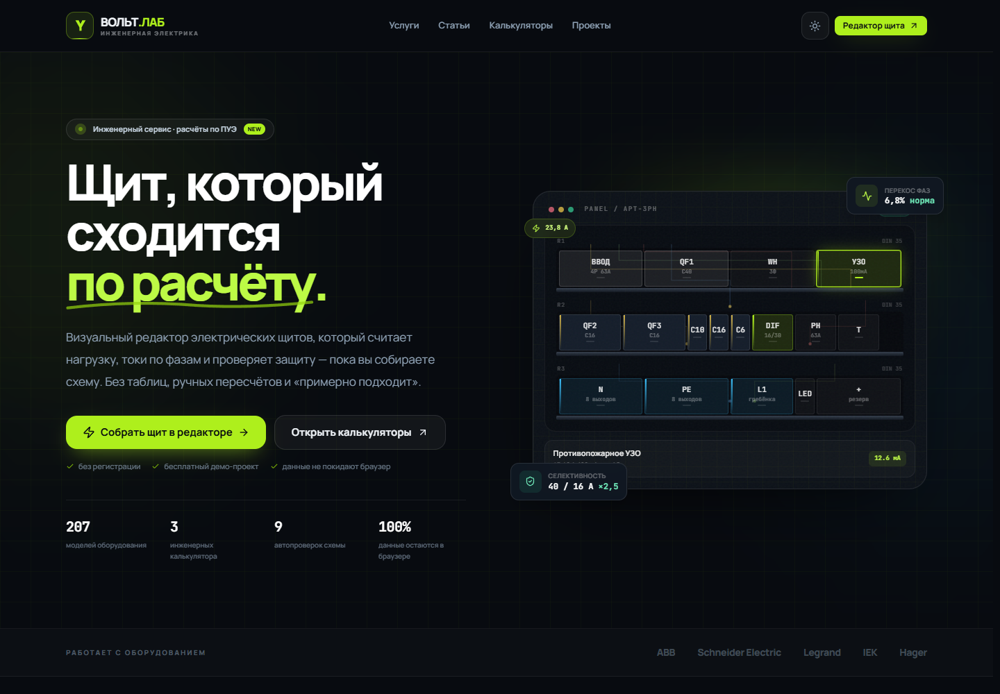
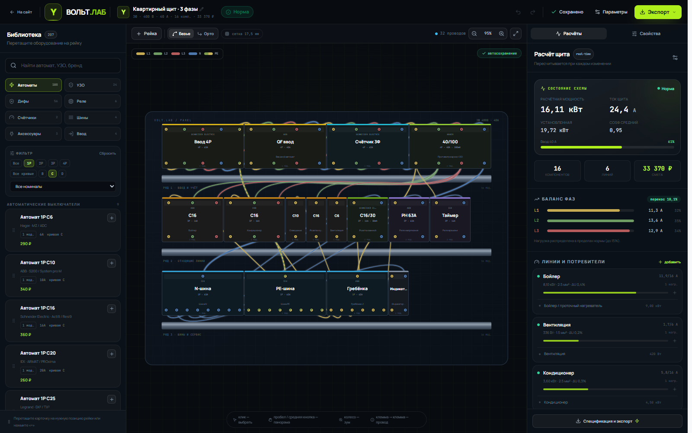
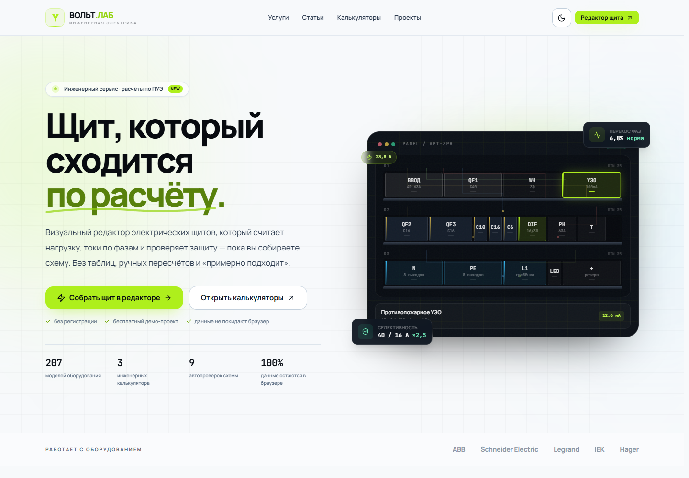
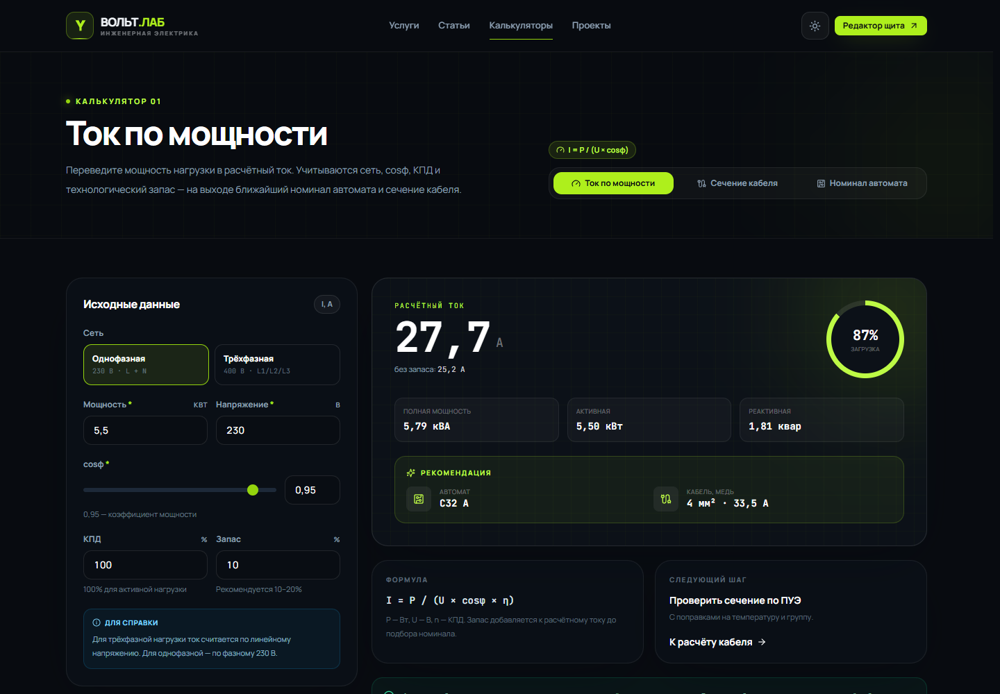

# ВОЛЬТ.ЛАБ — сайт по электрике и онлайн-редактор щитов

Полноценный SPA-сервис для электриков: публичный сайт, инженерные калькуляторы, справочник,
личный кабинет и главный модуль — визуальный редактор сборки электрического щита с расчётом
нагрузок, проверкой защит и экспортом документации.




Светлая тема и страница калькулятора:




## Что реализовано

### Публичная часть
- Главная страница с интерактивным демо-щитом и презентацией возможностей.
- Каталог статей с фильтрацией, поиском и полноценными материалами по электрике.
- Страница услуг с пакетами, процессом и FAQ.
- Три калькулятора:
  - ток по мощности (1/3 фазы, cosφ, КПД, запас);
  - сечение кабеля по току или мощности с таблицей ПУЭ, поправками и ΔU;
  - подбор номинала автомата с согласованием с кабелем.
- Светлая и тёмная темы, адаптивная вёрстка, локальные шрифты Manrope и JetBrains Mono.

### Личный кабинет
- Список сохранённых проектов в `localStorage`.
- Создание пустого проекта или проекта на основе демо-схемы.
- Переименование, дублирование, удаление и открытие проекта в редакторе.
- Автосохранение изменений в черновик и в сохранённый проект с задержкой.
- Импорт/экспорт резервной копии JSON.

### Редактор щита `/editor`
- Библиотека из 207 моделей: автоматы 1P–4P (B/C/D, 6–63 А), УЗО (2P/4P, 10–300 мА),
  дифавтоматы, реле, контакторы, счётчики, шины N/PE/L, кросс-модули, розетки, звонки,
  индикаторы, вводные разъединители и клеммные блоки.
- Компоновка на нескольких DIN-рейках: drag & drop из палитры, перетаскивание по рейке,
  точная привязка к модулям, свободные окна без принудительного уплотнения, копирование,
  удаление, undo/redo.
- Зум колесом, панорамирование пробелом/средней кнопкой, touch-панорама, вписывание в экран.
- Клеммы L1/L2/L3/N/PE на вход и выход. Соединение «клемма → клемма» с проверкой:
  - запрет фазного КЗ на N/PE;
  - запрет объединения N и PE;
  - запрет межфазного замыкания;
  - запрет соединения нейтралей за разными УЗО;
  - защита от дублирующих проводов.
- Ошибка соединения подсвечивается кольцами на клеммах и уведомлением.
- Провода: Безье/ортогональная трассировка, цвет по типу и фазе, сечение, изменение типа и цвета,
  удаление. Маркировка L1 — жёлтый, L2 — зелёный, L3 — красный, N — синий, PE — зелёный/жёлтый. Проблемные аппараты обводятся красным/жёлтым по результатам расчёта.
- Потребители привязываются к защитным линиям: мощность, cosφ, коэффициент использования,
  однофазное/трёхфазное подключение и фаза.
- Настройки кабеля каждой линии: сечение, медь/алюминий, ПВХ/XLPE, способ прокладки,
  температура, число кабелей в трассе, длина.
- Расчёт в реальном времени: баланс фаз, перекос, токи, загрузка ввода, утечки УЗО,
  селективность, согласование кабеля.
- Экспорт: PNG, SVG, однолинейная схема SVG, PDF-смета, CSV-смета, JSON.
- Импорт проекта JSON с валидацией структуры.

## Технологии

- Vue 3.5 + Composition API + `<script setup lang="ts">`
- TypeScript 5.7, строгий режим, без `any`
- Vite 6
- TailwindCSS 3 с собственным дизайном и dark mode
- Pinia
- Vue Router
- jsPDF + html2canvas для PDF-сметы
- Vitest для доменных тестов
- Playwright (Chrome) для браузерных smoke-тестов в процессе разработки

## Запуск

```bash
pnpm install
pnpm dev
```

Приложение будет доступно на `http://127.0.0.1:5173`.

```bash
pnpm test        # 19 доменных тестов
pnpm typecheck   # строгая проверка TypeScript
pnpm build       # production-сборка
pnpm preview     # предпросмотр собранного приложения
```

## Почему SVG, а не Konva.js

В ТЗ предлагалось сначала рассмотреть Konva. Для этого проекта выбран **чистый SVG**.
Сравнение по ключевым критериям:

| Критерий | SVG (выбрано) | Konva.js | Fabric.js | PixiJS | Canvas 2D |
|---|---|---|---|---|---|
| 100–300 элементов | Отлично | Отлично | Хорошо | Отлично | Хорошо |
| 1000+ элементов / анимации | Средне | Отлично | Средне | Отлично | Хорошо |
| Drag & drop | Нативно через pointer events | Встроенный drag | Встроенный | Нужно писать | Нужно писать |
| Hit-тесты | DOM / `elementFromPoint` | Собственный hit graph | Собственный | Собственный | Вручную |
| Кривые провода | `d` path, Безье, ортогональные сегменты | `Konva.Line` / Shape | Path | Graphics | Ручная отрисовка |
| Векторный экспорт | Нативный SVG через XMLSerializer | `toDataURL` (растр), SVG — вручную | `toSVG` | Нет нативного SVG | Нет |
| Стилизация/темы | CSS, Tailwind, переменные | Canvas-свойства | Canvas-свойства | WebGL-шейдеры | Canvas |
| Доступность | DOM-семантика и фокус | Ограничена | Ограничена | Ограничена | Нет |
| Интеграция с Vue | Декларативные вычисляемые атрибуты | Императивные узлы | Императивные объекты | Императивная сцена | Императивная |
| Вес решения | 0 КБ дополнительно | ~150+ КБ | ~250+ КБ | ~400+ КБ | 0 КБ |

**Вывод.** Типичный щит содержит 12–80 модулей, а не тысячи объектов. Для такого масштаба SVG
даёт лучший баланс: декларативная реактивность Vue, простые hit-тесты, CSS-темы, качественный
векторный экспорт и отсутствие тяжёлой зависимости. Konva стала бы лучшим выбором при переходе
к 1000+ элементам, сложным анимациям и WebGL-сцене. Архитектура редактора изолирует геометрию
(`layoutEngine`) и отрисовку, поэтому слой можно заменить на Konva без переписывания расчётов.

## Архитектура

```text
src/
  components/
    articles/                 # карточка статьи
    calculators/              # общая навигация калькуляторов
    common/                   # кнопки, модальные окна, статусы, toast
    editor/
      PanelCanvas.vue         # SVG-холст, DnD, провода, зум/пан
      PalettePanel.vue        # библиотека и фильтры
      EditorToolbar.vue
      CalculationPanel.vue    # расчёты, линии, УЗО, селективность
      PropertiesPanel.vue     # свойства аппарата/провода/проекта
      ConsumerDialog.vue
      ProjectSettingsDialog.vue
      ExportDialog.vue
    home/                     # интерактивный hero-щит
    layout/                   # публичный layout, шапка, подвал
  composables/
    usePageMeta.ts            # SEO title/description
    useZoomPan.ts             # зум и панорамирование
  config/editor.ts            # геометрия DIN-рейки, константы
  data/
    articles.ts               # статьи и блоки контента
    demo.ts                   # демо-проект и пустой проект
    library.ts                # каталог 207 моделей
    pue.ts                    # таблица ПУЭ и функции токов
  router/index.ts
  services/
    calcEngine.ts             # чистый расчётный движок
    exportService.ts          # PNG/SVG/PDF/CSV/JSON
    layoutEngine.ts           # чистая геометрия и перестановки
    projectSerialization.ts   # парсинг/скачивание JSON
    validationEngine.ts       # граф связей и правила соединений
    engines.test.ts
  stores/
    libraryStore.ts
    panelStore.ts             # текущий проект, история, черновик
    projectsStore.ts          # личный кабинет, localStorage
    uiStore.ts                # тема, тосты, мобильные панели
  types/index.ts              # все доменные типы
  utils/
  views/
    calculators/
    ...
```

### Поток данных

```text
SVG/DOM events
      ↓
Pinia panelStore (единственный источник истины проекта)
      ↓
layoutEngine → координаты компонентов и клемм
validationEngine → допустимость соединений и ошибки
calcEngine → токи, фазы, кабели, УЗО, селективность
      ↓
computed-состояние → SVG-холст, панели, смета
```

Расчётные движки не импортируют Vue и DOM. Это позволяет тестировать их в Node и
переиспользовать вне интерфейса.

## Расчётные формулы

### Ток нагрузки
- Однофазная сеть: `I = P / (U × cosφ × η)`
- Трёхфазная сеть: `I = P / (√3 × U × cosφ × η)`
- Учитываются коэффициент использования и запас.

### Кабель
- `Iдоп = Iтабл × Kтемп × Kгруппы × Kпрокладки`
- Таблица ПУЭ содержит медь/алюминий и ПВХ/XLPE.
- Сечение выбирается, если одновременно `Iдоп ≥ Iрасч` и `ΔU ≤ лимит`.
- Проверяется согласование: `In ≤ Iдоп` и кабель защищён автоматом.

### Падение напряжения
- Однофазная линия: `ΔU = 2 × I × L × ρ × cosφ / S`
- Трёхфазная: `ΔU = √3 × I × L × ρ × cosφ / S`
- Добавлена оценка индуктивной составляющей.

### УЗО
- Естественная утечка: `0,4 мА × Iлинии + 0,5 мА × число нагрузок`.
- Требуемая уставка: `Iут.расч × 3`.
- Сравнивается с номинальным дифференциальным током УЗО/дифавтомата.

### Перекос фаз
- `δ = max|Iф − Iср| / Iср × 100%`.
- До 15% — норма, 15–25% — предупреждение, выше 25% — ошибка.

### Селективность
- Для каждой линии строится цепочка вышестоящих защит по графу проводов.
- Проверяется `Iввод ≥ 1,6 × Iлинии`, сравнение кривых B/C/D и предупреждение о спорных сочетаниях.

## Валидация соединений

При попытке проложить провод проверяются:
1. Клеммы существуют и принадлежат разным аппаратам.
2. Провод не дублирует уже существующий.
3. PE не соединяется с L/N.
4. N и PE не объединяются.
5. Фаза не замыкается напрямую на N.
6. Разные фазы не соединяются напрямую. Исключение — подача L2/L3 на обобщённый
   фазный вход однополюсного/двухполюсного аппарата.
7. Нейтрали цепей за разными УЗО не объединяются.

Для поиска вышестоящих аппаратов используется направленный обход графа: от входных клемм
линии по проводам к выходным клеммам вышестоящих аппаратов и далее через внутреннюю
проводимость `out → in`. Это не «захватывает» соседние отходящие линии через общую шину.

## Экспорт

- **PNG** — снимок всей схемы в 2× разрешении, без служебных selection-элементов.
- **SVG** — весь холст, инлайн-стили, пригоден для печати и вставки в документацию.
- **Однолинейная схема SVG** — упрощённая схема «ввод → шина → автомат → потребитель»,
  с токами, сечением, ΔU и статусом каждой линии.
- **PDF-смета** — A4, локальный рендер через html2canvas + jsPDF, итоговая стоимость и
  спецификация. Текст в PDF рендерится как изображение, поэтому кириллица отображается корректно.
- **CSV** — спецификация с BOM для Excel.
- **JSON** — полный проект со всеми проводами, нагрузками и настройками кабелей.

## Хранение

- `voltlab.projects.v1` — список сохранённых проектов.
- `voltlab.draft.v1` — текущий черновик редактора.
- `voltlab.theme` — выбранная тема.
- Данные не отправляются на сервер. Очистка localStorage удаляет проекты.

## Тестирование

```bash
pnpm test
```

Покрыто:
- раскладка компонентов и отсутствие наложений;
- стабильность uid клемм;
- перестановка на рейке;
- расчёт демо-проекта;
- обнаружение перегрузки;
- формулы тока;
- запрет опасных соединений;
- подбор кабеля по ПУЭ;
- round-trip импорта/экспорта JSON.

Дополнительно в ходе разработки выполнялись браузерные smoke-тесты (Playwright + установленный
Chrome): все маршруты, drag & drop, добавление/удаление/undo, сохранение и автосохранение,
создание нагрузки, импорт, все форматы экспорта, мобильные панели, светлая/тёмная тема.

## Ограничения и что дальше

- Нет бэкенда и авторизации: проекты хранятся локально в браузере.
- Таблицы ПУЭ — справочные, для проектирования нужна проверка по актуальной редакции и
  документации производителя.
- Цены в библиотеке — демонстрационные, не являются публичной офертой.
- PDF-смета рендерится в растр; для поиска по тексту PDF потребуется встроить шрифт с
  кириллицей и формировать PDF векторно.
- Следующие шаги: серверное хранение и шаринг, версии проектов, печать по ГОСТ, расширенные
  время-токовые характеристики, тепловой расчёт щита, интеграция с поставщиками оборудования.
